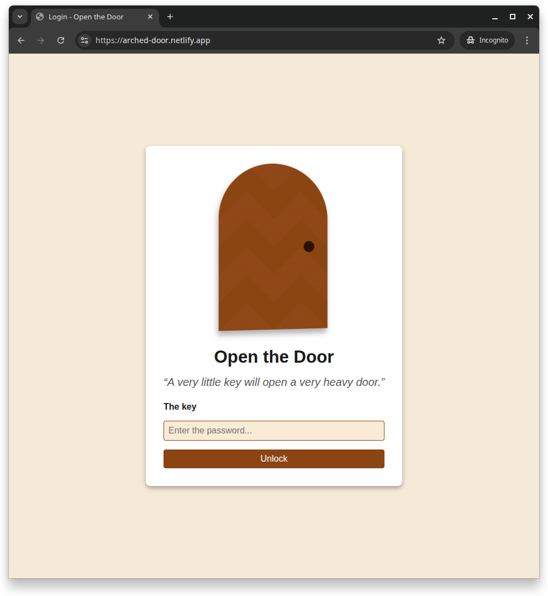
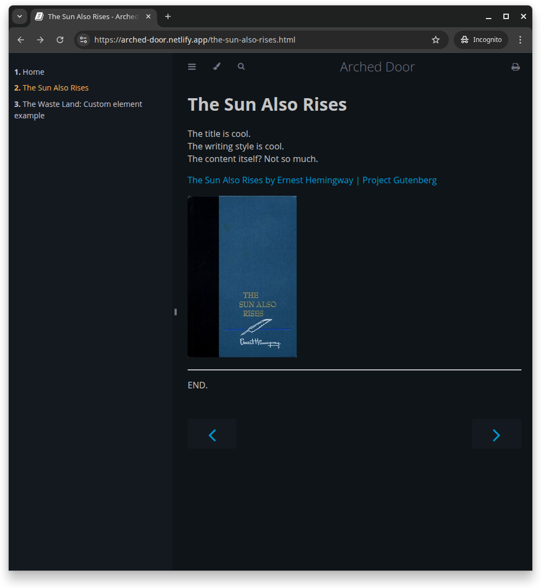

# Arched Door (POC)

**Arched Door** is a POC of how an internal documentation website could be made. \
(Check [the original README](./README-hatter.md).)

**Live demo**:
- Website: https://arched-door.netlify.app/
- Default password: `somepassword`

| Login page                     | Content page                   |
|:------------------------------:|:------------------------------:|
|  |  |

## Usage

- `mdbook serve`

- `export-tldraw.sh`
  * Exports all `*.tldr` files to `*.tldr.svg`
  * Uses [tldraw-cli](https://github.com/kitschpatrol/tldraw-cli)
  * Assumes `npx` (from Node.js) to be present.

## Overview

It's not about a specific tech, it's about the process:

- Write in plain markdown (or GitHub Flavored Markdown).

- Generate a static website.

- Add auth.

## Technologies used

- [mdBook](https://github.com/rust-lang/mdBook).
    * Why?
        + Simple and works perfectly.
        + Supports plugins (inc. `pandoc`).
    * Installation: `cargo install mdbook`

- GitHub Actions
  * [x] [Quickstart for GitHub Actions | GitHub Docs](https://docs.github.com/en/actions/writing-workflows/quickstart)
  * [ ] [GitHub Action: Install Rust Toolchain](https://github.com/actions-rust-lang/setup-rust-toolchain)
  * [ ] `act` https://github.com/nektos/act
    + Running GitHub Actions locally.

- Netlify
    * Why? We're more used to Netlify. It's straightforward to use.
    * Alternatives:
        + Vercel.
          See [their middleware example](https://github.com/vercel/examples/blob/main/edge-middleware/basic-auth-password/middleware.ts).

## Branding

Main theme: Desert. Algerian Desert.

### Naming

**Arched Door** is the final choice.

  - **Arched**:

      * Literally an arched door.

      * "Arch" as in _arch_itecture, suggesting it is tech-related.

  - **Door**:

      * Charles Dickens' door quote.

      * Think: Door of knowledge.

Other options:

- [ ] Brainiac Hatter (Alice in Wonderland)

- [ ] Stellar Almanac (astronomy-related)

## Technical details

### About mdBook

See [about-mdbook.md](./about-mdbook.md).

### About the GitHub Action

The GitHub Action expects the following environment secrets:
- `NETLIFY_AUTH_TOKEN`
- `NETLIFY_SITE_ID`

It uses a prebuilt binary (fast) and falls back to building from the source (slow).

## License

WTFPL
